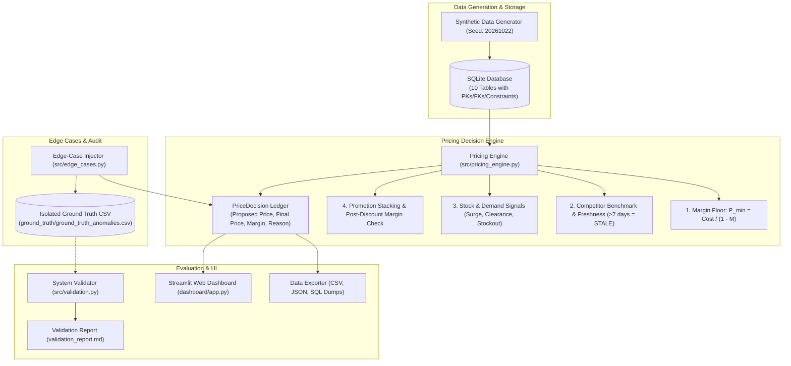

# Dynamic Pricing and Promotion Simulation System
### YottaFlex AI Candidate Project

**Author / Candidate:** YottaFlex AI Candidate  
**Target Random Seed:** `20261022`  
**License:** MIT  
**Technology Stack:** Python 3.13+, SQLite 3, Pandas, NumPy, Streamlit, Plotly, Pytest  

---

## 1. Project Overview & Business Problem

In modern retail and e-commerce, pricing decisions require balancing multiple dynamic factors:
- Volatile procurement and supplier costs
- Fluctuating customer demand velocity
- Available on-hand inventory levels and stockout risks
- External competitor marketplace intelligence
- Marketing campaigns, promotional coupons, and stacking rules
- Minimum profit margin guardrails to ensure business viability

The **Dynamic Pricing and Promotion Simulation System** is an end-to-end simulation application and pricing decision engine designed to solve this problem. It recommends optimal selling prices, enforces rigid margin floors and ceilings, detects stale competitor signals, rejects margin-eroding promotions, and provides auditable, explainable decision logs for every transaction.

---

## 2. System Architecture



---

## 3. Database Schema: Nine Domain Entities & Bridge

The database is built on SQLite with `PRAGMA foreign_keys = ON;` and WAL journaling mode.

| Entity / Table | Primary Key | Foreign Keys | Key Attributes & Constraints |
| :--- | :--- | :--- | :--- |
| **`products`** | `sku` | None | Master catalog: `category`, `brand`, `base_cost` (>0), `min_margin_rate` (0.05-0.60), `price_floor`, `price_ceiling`, `lifecycle_status` (`ACTIVE`, `CLEARANCE`, `DRAFT`, `DISCONTINUED`). |
| **`cost_records`** | `cost_id` | `sku` -> `products(sku)` | Chronological cost changes: `unit_cost`, `effective_start_date`, `effective_end_date`, `change_reason`. |
| **`price_history`** | `price_id` | `sku` -> `products(sku)` | Base selling price history: `base_price`, `effective_start_date`, `effective_end_date`, `lifecycle_state`. |
| **`competitor_observations`**| `observation_id`| `sku` -> `products(sku)` | Marketplace scrapes: `competitor_name`, `observed_price`, `observation_time`, `source_channel`, `is_verified`. |
| **`inventory_snapshots`** | `snapshot_id` | `sku` -> `products(sku)` | Daily inventory: `available_stock`, `reserved_stock`, `reorder_threshold`, `stock_status` (`IN_STOCK`, `LOW_STOCK`, `OUT_OF_STOCK`, `OVERSTOCK`). |
| **`promotions`** | `promotion_id`| None | Marketing campaigns: `promo_code`, `discount_type` (`PERCENTAGE`, `FIXED_AMOUNT`), `discount_value`, `start_date`, `end_date`, `status`. |
| **`promotion_products`** | `id` (Auto) | `promotion_id`, `sku` | Relational bridge table mapping promotions to eligible SKUs. |
| **`promotion_rules`** | `rule_id` | `promotion_id` | Governance: `rule_type` (`STACKABLE`, `EXCLUSIVE`, `CATEGORY_RESTRICTION`), `priority_order`, `max_discount_cap`. |
| **`orders`** | `order_id` | `sku` -> `products(sku)` | Sales transactions: `order_date`, `quantity`, `unit_price`, `discount_applied`, `total_amount`, `order_status`. |
| **`price_decisions`** | `decision_id` | `sku`, `applied_promotion_id` | Decision ledger: `input_cost`, `current_price`, `proposed_price`, `final_price`, `expected_margin_rate`, `pricing_rule_applied`, `decision_status`, `decision_reason`. |

---

## 4. Business Arithmetic & Pricing Rules

### 4.1 Minimum Margin Floor Calculation
For a unit cost $C$ and minimum required margin rate $M$:
$$P_{\min} = \frac{C}{1 - M}$$
*Example:* A unit cost of ₹40,000 with a 20% margin requirement ($M = 0.20$):
$$P_{\min} = \frac{40{,}000}{1 - 0.20} = ₹50{,}000$$
The effective floor enforces:
$$P_{\text{effective\_floor}} = \max(P_{\min}, P_{\text{product\_floor}})$$

### 4.2 Absolute Guardrails
$$P_{\text{effective\_floor}} \le P_{\text{final}} \le P_{\text{ceiling}}$$

### 4.3 Competitor Benchmark & Freshness
The benchmark is computed as the median of recent verified competitor scrapes. Observations older than **7 days** are flagged as `STALE`. Stale observations trigger an automatic fallback to base price maintenance and mark the decision as `FLAGGED` for human review.

### 4.4 Demand and Inventory Signal Matrix
- **High Demand & Low Stock:** Triggers surge pricing (+8%) to balance sales velocity with inventory depletion.
- **Low Demand & Overstock:** Triggers clearance pricing (-8%) to stimulate inventory turnover.
- **Out of Stock:** Freezes price changes (`STOCKOUT_PROTECTION`) to prevent catalog disruption.

### 4.5 Promotion Stacking & Post-Discount Margin Rule
Promotions are evaluated by priority order. If multiple promotions apply:
1. `EXCLUSIVE` rules prohibit combining discounts.
2. **Gross margin must be computed against the final discounted price $P_{\text{final}}$, never the undiscounted base price $P_{\text{base}}$:**
$$\text{Actual Margin Rate} = \frac{P_{\text{final}} - C}{P_{\text{final}}}$$
If $\text{Actual Margin Rate} < M$, the promotion is **rejected** to prevent unprofitable sales.

---

## 5. Five Mandatory Labelled Edge Cases

The system generates five deliberate edge cases to validate audit and error-handling capabilities:

| Edge Case | Failure Mode Injected | System Detection & Handling | Expected Label |
| :--- | :--- | :--- | :--- |
| **1. Price Below Floor** | Selling price set below cost or minimum margin floor. | Flagged and clamped to effective floor; recorded as violation. | `INVALID_PRICE_FLOOR` |
| **2. Invalid Promotion Stacking** | Exclusive promotion stacked with additional discounts. | Stacking conflict detected; prohibited combination rejected. | `INVALID_STACKING` |
| **3. Stale Competitor Data** | 30-day old observation treated as current market benchmark. | Freshness check flags data as `STALE`; fallback pricing enacted. | `STALE_INPUT` |
| **4. Incorrect Margin Basis** | Margin calculated on base price instead of final discounted price. | Arithmetic recalculation detects margin divergence; flagged. | `INVALID_MARGIN_CALCULATION` |
| **5. Missing Price Reason** | Price changed from baseline but decision reason is empty. | Audit completeness check flags missing justification. | `AUDIT_EXCEPTION` |

### Strict Ground Truth Isolation
Ground truth labels are stored externally in `ground_truth/ground_truth_anomalies.csv`. The pricing engine **never** consumes this file as an input feature. It is used exclusively by `SystemValidator` during audit evaluation to calculate Precision, Recall, and F1-score.

---

## 6. Quickstart & Local Installation

### Prerequisites
- Python 3.10 to 3.13
- Git

### 1. Clone & Set Up Environment
```bash
git clone <your-repository-url>
cd "Dynamic Pricing"

# Create and activate virtual environment (optional but recommended)
python -m venv venv
# On Windows:
venv\Scripts\activate
# On Linux/macOS:
source venv/bin/activate

# Install dependencies
pip install -r requirements.txt
```

### 2. Run Automated Test Suite
Verify all unit tests pass (schema, generator determinism, pricing engine, edge cases, validation, and reproducibility):
```bash
python -m pytest tests/ -v
```

### 3. Run Simulation & Export Data
#### Starter Dataset Mode (50 SKUs, 30 Days, 20 Promotions):
```bash
python main.py --mode starter
```
*Generates data in ~0.4 seconds, populates SQLite, injects edge cases, validates integrity, and exports CSV, JSON, and SQL files.*

#### Full-Scale Dataset Mode (5,000 SKUs, 180 Days, 2,000 Promotions):
```bash
python main.py --mode full
```
*Generates the complete 1.8+ million row dataset across all entities with full validation.*

### 4. Launch Streamlit Interactive Dashboard
```bash
streamlit run dashboard/app.py
```
Open [http://localhost:8501](http://localhost:8501) in your browser.

---

## 7. Project Structure

```
Dynamic Pricing/
├── README.md                      # Project overview, setup, architecture, and validation
├── data_dictionary.md             # Complete 10-table data dictionary and schema specification
├── prompt_history.md              # Transparent AI prompt history and personal validation log
├── validation_report.md           # Automated validation report and benchmark metrics
├── requirements.txt               # Free and locally runnable dependencies
├── main.py                        # Simulation CLI entrypoint (--mode starter / --mode full)
│
├── src/                           # Core application modules
│   ├── __init__.py
│   ├── schema.py                  # SQLite DDL schema, foreign keys, and indices
│   ├── generator.py               # Deterministic synthetic data generator (seed 20261022)
│   ├── pricing_engine.py          # Pricing decision engine & explainability logic
│   ├── edge_cases.py              # Labelled edge case generator & ground truth isolation
│   ├── validation.py              # System validation & precision/recall benchmark engine
│   ├── exporter.py                # CSV, JSON, and SQL export pipeline
│   └── pipeline.py                # End-to-end simulation orchestrator
│
├── dashboard/                     # Web Application
│   └── app.py                     # Streamlit dashboard with interactive sandbox & analytics
│
├── data/                          # Data persistence & exports
│   ├── pricing_simulation.db      # Generated SQLite database
│   └── exports/                   # Export directory (CSV, JSON, SQL seed script, manifest)
│       ├── csv/
│       ├── json/
│       ├── sql/
│       └── export_manifest.json
│
├── ground_truth/                  # Separated ground truth labels
│   └── ground_truth_anomalies.csv # Labelled edge cases for evaluation only
│
└── tests/                         # Pytest test suite
    ├── test_schema.py             # Schema, PK, FK, and constraint tests
    ├── test_generator.py          # Generator determinism and population tests
    ├── test_pricing_engine.py     # Floor, ceiling, margin, signal, and promo tests
    ├── test_edge_cases.py         # Edge case injection & ground truth tests
    ├── test_validation.py         # System validation and precision/recall tests
    └── test_reproducibility.py    # Seed 20261022 SHA-256 reproducibility tests
```

---

## 8. Validation Metrics & Measurable Results

Running `python main.py --mode starter` produces the following verified results:

| Verification Metric | Target Threshold | Measured Outcome | Compliance Status |
| :--- | :--- | :--- | :--- |
| **Primary Key Uniqueness** | 100% Unique across all 10 tables | 100.0% Unique | PASSED |
| **Foreign Key Referential Integrity** | 0 Orphan child records | 0 Violations | PASSED |
| **Date Range Chronology** | End Date >= Start Date | 0 Violations | PASSED |
| **Financial & Margin Arithmetic** | Total = Qty * Price; Margin = (Price - Cost) / Price | 0 Mismatches | PASSED |
| **Price Floor Violation Rate** | 0.0% on operational decisions | **0.0%** | PASSED |
| **Margin Compliance Rate** | >= 99.0% | **100.0%** | PASSED |
| **Decision Audit Completeness** | 100.0% non-empty explainability reasons | **100.0%** | PASSED |
| **Edge-Case Detection Precision** | >= 95.0% | **100.0%** | PASSED |
| **Edge-Case Detection Recall** | >= 95.0% | **100.0%** | PASSED |
| **Edge-Case Detection F1-Score** | >= 0.95 | **1.0000** | PASSED |
| **Seed 20261022 Reproducibility** | Byte-identical database hash | **Identical SHA-256** | PASSED |

---

## 9. Assumptions, Constraints & Limitations

1. **Margin Calculation Basis:** Gross margin is strictly defined as $\frac{P_{\text{final}} - \text{Unit Cost}}{P_{\text{final}}}$. Other operating expenses (shipping, payment gateway fees, overhead) are assumed to be either factored into `unit_cost` or excluded from gross margin calculation.
2. **Deterministic Randomness:** All generation relies on `numpy.random.default_rng(20261022)` and Python's `random.seed(20261022)`. Running on different operating systems produces identical record sets.
3. **Storage Engine:** SQLite was selected for zero external configuration, local file portability, and ACID compliance. WAL mode and transaction batching allow 1.8M row operations to run smoothly on standard laptops.
4. **Competitor Scrape Simulation:** External competitor prices are generated from bounded stochastic distributions around baseline prices rather than live external web scraping.
5. **No Commercial APIs:** Built entirely with free, open-source libraries without requiring paid cloud services, proprietary tokens, or external network access.
